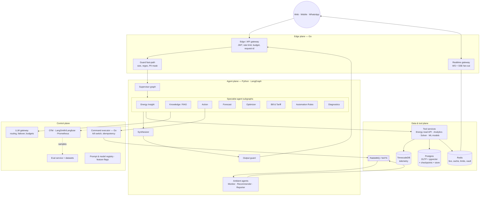
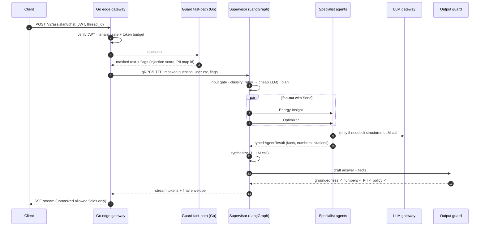

# 01 — Architecture Overview

## 1. Where we are vs where we are going

| Area | Today (repo) | Target |
|---|---|---|
| Orchestration | One LangGraph Q&A graph (`assistant/graph`) plus a separate action graph (`assistant/actions/graph.py`) | **Supervisor graph** that routes to specialist **agent subgraphs** and runs several in parallel |
| Agents | Implicit: intents map to tool plans | Explicit, versioned agents with their own prompts, tools, evals and SLOs ([02](./02-agent-catalog.md)) |
| Checkpointing | `MemorySaver` in the action graph | `AsyncPostgresSaver`. Pending confirmations survive restarts and work across replicas |
| Memory | None between questions | Thread memory (checkpointer) plus long-term user memory (LangGraph `Store`) |
| Guardrails | Regex device-control/jailbreak checks, schema output, data minimisation | Layered guard pipeline: Go fast-path, ML classifier, groundedness and numeric checks, PII vault ([04](./04-guardrails-gates-masking.md)) |
| Evals | `evals/cases.py` (26 cases, fake LLM) | Offline, trajectory, LLM-judge, red-team and online sampling, all gated in CI ([05](./05-evals.md)) |
| Hot paths | Python ingest worker, FastAPI WS, in-memory rate limit | Go ingest, Go realtime gateway, Go edge gateway with Redis limits ([06](./06-golang-performance-plane.md)) |
| Background intelligence | Alerts + recommendations modules | Event-driven **ambient agents** triggered by telemetry, schedules and documents |

## 2. The four planes



| Plane | Language | Why |
|---|---|---|
| **Edge** | Go | Thousands of connections and requests, mostly I/O and CPU-light checks. Go's goroutines and low memory per connection beat a Python ASGI worker here |
| **Agent** | Python | LangGraph, LangChain, provider SDKs, eval tooling and ML libraries are Python-first. LLM latency (hundreds of ms to seconds) dominates, so language speed is not the bottleneck |
| **Data & tools** | Mixed | Read tools stay Python (they reuse `EnergyService`) until profiling says otherwise. Ingest moves to Go |
| **Control** | Mixed | Command executor is Go (safety-critical, deterministic, long-running). LLM gateway can be an off-the-shelf Go gateway or a thin Go service |

## 3. Three ways work enters the system

| Path | Trigger | Shape | Latency budget | Example |
|---|---|---|---|---|
| **Conversational** | User message | Supervisor → 1..N agents in parallel → synthesizer → stream | p95 < 4 s full answer, first token < 1.2 s | "Why am I importing power and should I run the geyser?" |
| **Ambient (event-driven)** | Telemetry tick, alert rule, document upload | Go rule engine filters → queue → ambient agent → notification | Seconds to minutes | Battery below reserve during an outage, so notify with an explanation |
| **Scheduled (batch)** | Cron | Fan-out per household → agent → store/notify | Hours | Daily recommendation, weekly report, monthly bill reconciliation |

Only the conversational path holds a user connection open. The other two run on workers off the queue, so a
spike in ticks can never slow down chat.

## 4. Conversational request — end to end



## 5. Layering inside the Python agent service

```
transport/        FastAPI (internal) + gRPC server — no business logic
application/      ChatService, AmbientService, BatchService — build runtime ctx, invoke graphs
orchestration/    supervisor graph, synthesizer, gates (as graph nodes)
agents/<name>/    one package per agent: graph.py, prompts/, tools.py, schemas.py, evals/
guardrails/       input & output guards, PII vault client, policy engine client
domain/           existing pure-Python analytics, intents, context, projection, safety (unchanged)
tools/            tool registry, gateways (EnergyDataGateway etc.), tool authZ wrapper
platform/ai/      existing app/ai: model factory, structured LLM gateway, settings
platform/infra/   checkpointer, store, cache, telemetry, flags
```

Dependencies only point down. `domain/` never imports LangChain, which keeps the deterministic core testable and
reusable from the Go side through a thin API if needed.

## 6. Design principles (enterprise version)

| Principle | Concrete rule |
|---|---|
| **Deterministic core** | Analytics, safety checks, tariff maths, schedule solving are code. The LLM gets results, never raw rows |
| **Bounded autonomy** | Each agent has an autonomy level L0–L3 ([02 §2](./02-agent-catalog.md)). Anything that changes the physical world is L2 or lower, which means a human confirms |
| **Typed contracts** | Every agent returns `AgentResult` (Pydantic). The supervisor never parses free text from another agent |
| **Tenant isolation by construction** | `household_id`/`user_id` come from runtime context bound at the edge. They are never tool arguments the LLM can fill |
| **Fail closed for actions, fail soft for answers** | Action path: any error means no command. Answer path: any error means a deterministic fallback answer |
| **Cost is a first-class SLO** | Token budget per request, per user per day, and per tenant per month, enforced at the edge and in the LLM gateway |
| **Everything is replayable** | Checkpoints + traces + prompt versions let you rerun any production conversation in eval |
| **Provider-agnostic** | Agents ask for a role (`router`, `answer`, `judge`, `extract`). The registry maps role to model. Switching vendor is config |

## 7. Non-functional targets (initial SLOs)

| Metric | Target |
|---|---|
| Chat first token p95 | ≤ 1.2 s |
| Chat full answer p95 (single agent) | ≤ 3 s |
| Chat full answer p95 (multi-agent, 3 parallel) | ≤ 5 s |
| Rule-routed share of questions | ≥ 85 % |
| Avg LLM calls per question | ≤ 1.3 |
| Action path: unsafe command published | 0, tested by red-team suite on every release |
| Groundedness (numbers in answer present in facts) | ≥ 99.5 % |
| Availability (chat endpoint) | 99.9 % monthly |
| Telemetry ingest | Sustain 10× current tick rate with p99 store latency < 200 ms |

Measure these from day one ([08](./08-observability-llmops.md)). Treat the numbers as starting targets to tune
after the first month of real traffic, not as guarantees.
