# 02 — Agent Catalog

Every agent here is a **LangGraph subgraph** with its own prompts, tools, output schema, eval suite and owner.
"Agent" does not mean "LLM loop". Several of these agents are mostly deterministic and call an LLM once, or never.

## 1. Agent types

| Type | Lives where | Triggered by | Examples |
|---|---|---|---|
| **Orchestrator** | Agent plane | Every chat request | Supervisor, Synthesizer |
| **Conversational specialist** | Agent plane (subgraph) | Supervisor handoff | Energy Insight, Knowledge, Bill & Tariff |
| **Task agent** | Agent plane | Supervisor or another agent, one job | Automation Rule Builder, Onboarding Extractor |
| **Action agent** | Agent plane + Go executor | Supervisor, with human confirmation | Device Action |
| **Ambient agent** | Worker pool | Events from the queue | Monitor, Recommender |
| **Batch agent** | Worker pool | Cron | Reporter, Bill Reconciler |
| **Guard / judge agent** | Inline + eval service | Every request / sampled | Input Guard, Output Judge |

## 2. Autonomy levels

| Level | Meaning | Who approves | Agents |
|---|---|---|---|
| **L0** Inform | Reads and explains only | Nobody | Energy Insight, Knowledge, Forecast, Diagnostics |
| **L1** Suggest | Produces a plan or recommendation, stores it | Nobody, user acts manually | Optimizer, Recommender, Bill & Tariff |
| **L2** Act with confirmation | Prepares a command, pauses on `interrupt`, user confirms | User, every time | Device Action, Automation Rule activation |
| **L3** Act within policy | Executes inside a pre-approved rule, can be stopped by kill switch | User approved the rule once | Rule Executor (Go, **no LLM in the loop**) |

Hard rule: **no LLM ever runs at L3.** L3 execution is a Go rule engine evaluating a validated DSL that a human
approved at L2. The LLM's job ends when it produces the rule draft.

## 3. Agent map

```mermaid
flowchart TB
  SUP{{Supervisor}}
  SUP --> EI[Energy Insight Agent]
  SUP --> KN[Knowledge Agent]
  SUP --> BT[Bill & Tariff Agent]
  SUP --> FO[Forecast Agent]
  SUP --> OP[Optimizer Agent]
  SUP --> AC[Device Action Agent]
  SUP --> AU[Automation Rule Agent]
  SUP --> DG[Diagnostics Agent]
  SUP --> ON[Onboarding Agent]
  SUP --> SYN[[Synthesizer]]

  EI --> EI1[Live State] & EI2[Battery & Backup] & EI3[Grid & Export] & EI4[Appliance Advisor] & EI5[Savings]
  KN --> KN1[Query Rewriter] & KN2[Retriever] & KN3[Reranker] & KN4[Citation Verifier]
  BT --> BT1[Bill Extractor] & BT2[Tariff Engine] & BT3[What-if Simulator]
  AC --> AC1[Command Parser] & AC2[Safety Evaluator] & AC3[Confirmation HITL] & AC4[Publisher]
  AU --> AU1[NL→DSL Compiler] & AU2[Rule Validator] & AU3[Conflict Checker] & AU4[Dry-run Simulator]
  OP --> OP1[Schedule Solver] & OP2[Battery Strategy]
  DG --> DG1[Fault Lookup] & DG2[Telemetry Correlator] & DG3[Escalation]

  subgraph Ambient
    MON[Monitor Agent]
    REC[Recommender Agent]
    REP[Reporter Agent]
  end
```



## 4. Orchestrators

### 4.1 Supervisor

| Item | Detail |
|---|---|
| Job | Classify, plan which agents run (one or many), dispatch in parallel, collect results, hand to synthesizer |
| Built from | Existing `domain/intents.py` rule classifier and `graph/planner.py` |
| Routing cascade | 1) rules (regex + synonyms, 0 tokens) → 2) small classifier/embedding kNN (optional, ~5 ms) → 3) router LLM with structured output (`IntentClassification`) |
| Model tier | `router` (smallest, cheapest, e.g. Haiku-class / Flash-Lite-class) |
| Output | `Plan { agents: [AgentCall], requires_telemetry, live_advice, budget }` |
| Must not | Answer the user itself, or call data tools directly |

### 4.2 Synthesizer

| Item | Detail |
|---|---|
| Job | Merge 1..N `AgentResult`s into one answer in the house format (Observation / Explanation / Recommendation / Estimated impact / Data time) |
| Skip rule | If exactly one agent ran and it already produced a final answer, pass it through (0 extra tokens) |
| Model tier | `answer` (quality tier) |
| Input | Only `AgentResult.facts`, `numbers`, `citations`, `warnings`. Never raw tool output |
| Output | `FinalAnswer` + `claims[]` (each claim points at a fact id). The output guard uses this |

## 5. Conversational specialists

### 5.1 Energy Insight Agent (L0) — evolves today's assistant graph

| Item | Detail |
|---|---|
| Job | Explain live state, battery, grid, devices, savings, patterns, appliance timing |
| Sub-agents | Live State, Battery & Backup, Grid & Export, Appliance Advisor, Savings. These are **plan profiles over one subgraph**, not separate LLM loops. Each declares tools + analytics + `Detail` groups, exactly like today's planner |
| Tools | The existing 9 read tools via `EnergyDataGateway` (single-flight) |
| Analytics | Existing `domain/analytics.py` |
| LLM calls | 0–1 |
| Gates | Freshness gate, facts budget |

### 5.2 Knowledge Agent (L0) — evolves `modules/knowledge`

| Sub-agent | Job | LLM? |
|---|---|---|
| Query Rewriter | Expand "E04 on my Growatt" into brand + fault-code filters; HyDE optional | Small, optional |
| Retriever | Hybrid pgvector + BM25/lexical, metadata filters (brand, DISCOM, doc type, owner) | No |
| Reranker | Cross-encoder or LLM rerank of top 30 → top 5 | Small model / cross-encoder |
| Citation Verifier | Each claim must quote or point to a chunk id. Drops unsupported sentences | Deterministic + small judge |

Output always carries `citations[] {document_id, page, chunk_id}`. If nothing passes the relevance threshold,
it says "not in your documents" instead of guessing.

### 5.3 Bill & Tariff Agent (L1)

| Sub-agent | Job |
|---|---|
| Bill Extractor | Structured extraction from uploaded bill (existing `bills.py` regex first, LLM `extract` role only for missing fields, with confidence per field) |
| Tariff Engine | Deterministic slab / ToD / net-metering maths per DISCOM tariff order (versioned tariff tables, not prompts) |
| What-if Simulator | "What if I add 2 kW panels / a 5 kWh battery?" Runs the simulator engines over historical weather and load → payback, savings. Backs the frontend "bill simulator" card |

### 5.4 Forecast Agent (L0)

| Item | Detail |
|---|---|
| Job | Next 24–72 h solar generation, load, SOC trajectory |
| How | **ML models, not LLM**: gradient boosting / quantile regression on Timescale history + weather forecast. Fallback is the physics engines in `simulator/engines` driven by forecast weather |
| LLM | None in the agent. The synthesizer explains the forecast |
| Output | `Forecast { horizon, p10/p50/p90 series, model_version }` |

### 5.5 Optimizer Agent (L1)

| Sub-agent | Job |
|---|---|
| Schedule Solver | Best window for flexible appliances given forecast, tariff (ToD), battery reserve, priorities. MILP/CP-SAT or a greedy heuristic, no LLM |
| Battery Strategy | Charge/discharge/reserve plan for the day (self-consumption vs backup vs export goal) |

The LLM never invents a schedule. It gets `ScheduleOption[]` with costs and explains the trade-off.

### 5.6 Device Action Agent (L2) — evolves `assistant/actions`

```
parse → load facts → safety evaluate ─┬─ reject (explain why) → END
                                      └─ interrupt(confirm) ─┬─ declined → END
                                                             └─ re-load → re-evaluate → publish → Go executor
```

| Item | Detail |
|---|---|
| Keep | `safety.py` deterministic checks (RBAC, kill switch, reserve, critical device, freshness, duplicate, jailbreak) |
| Change | `MemorySaver` → `AsyncPostgresSaver` so confirmations survive restarts and work across replicas. Add confirmation TTL (e.g. 2 min) and re-check facts after resume (already done: load → decide after confirm) |
| Publish | Command goes to the queue with idempotency key, and the **Go Command Executor** applies kill switch + rate limit + device-level interlocks again before touching hardware |
| LLM | Optional, only for parsing ambiguous commands into `{device, command, duration}`, then validated against the household's device list |

### 5.7 Automation Rule Agent (L2 → L3)

Turns "when the battery is above 80 % and it is sunny, run the geyser for 30 minutes" into a rule.

| Sub-agent | Job |
|---|---|
| NL→DSL Compiler | LLM with structured output to a **closed JSON DSL** (`when`, `conditions[]`, `action`, `limits`) |
| Rule Validator | JSON schema + semantic checks (device exists, controllable, not critical-off, sane thresholds) |
| Conflict Checker | Detects overlaps and contradictions with existing rules |
| Dry-run Simulator | Replays the last 7 days of telemetry and shows how often it would have fired and the kWh/₹ effect |
| Activation | `interrupt` for user approval, then store. **Execution is the Go rule engine (L3), no LLM** |

### 5.8 Diagnostics Agent (L0)

| Sub-agent | Job |
|---|---|
| Fault Lookup | Fault code → Knowledge Agent (manual) |
| Telemetry Correlator | Checks the anomaly detectors in `analytics.py` against the last N hours (underperformance, hot battery, balance mismatch) |
| Escalation | Creates an installer/support ticket (L1 suggestion, user confirms before sending) |

### 5.9 Onboarding Agent (L1)

Prefills the onboarding wizard from a bill upload or an inverter/battery nameplate photo (vision `extract` role).
Every field shows its confidence, and the user confirms in the existing wizard. It never writes onboarding tables directly.

## 6. Ambient and batch agents

| Agent | Trigger | Pipeline | LLM |
|---|---|---|---|
| **Monitor** | Every tick, through the Go rule engine | Go evaluates thresholds/anomalies per tick → only state *changes* are enqueued → agent dedups, groups, decides severity → explanation → notification (existing `notifications/`) | 1 small call per *incident*, not per tick. Template text for known codes |
| **Recommender** | Daily + after major events | Forecast + Optimizer + history → top 3 recommendations → store in "Recommendation history" | 1 call per household per day, batched |
| **Reporter** | Weekly / monthly cron | Aggregates from Timescale continuous aggregates → narrative report → email/PDF | 1 call per report |
| **Bill Reconciler** | New bill uploaded | Bill Extractor vs metered kWh → flags discrepancy | 0–1 |

Use the provider **batch APIs** for Recommender and Reporter (typically about half the price, latency in hours is fine).

## 7. Guard and judge agents

| Agent | Where | Detail in |
|---|---|---|
| Input Guard | Go fast-path + Python classifier node | [04](./04-guardrails-gates-masking.md) |
| Output Guard | Node before stream completes | [04](./04-guardrails-gates-masking.md) |
| Online Judge | Async on sampled traces | [05](./05-evals.md) |
| Red-team Agent | CI + nightly | [05](./05-evals.md) |

## 8. Common agent contract

```python
class AgentCall(BaseModel):
    agent: AgentName                 # enum, not free text
    task: str                        # sub-question or profile name
    params: dict[str, Any] = {}      # validated per agent
    budget_tokens: int
    deadline_ms: int

class Fact(BaseModel):
    id: str                          # "battery.soc_percent"
    value: float | str | bool | None
    unit: str | None = None
    source: Literal["tool", "analytics", "rag", "forecast", "solver"]
    as_of: datetime | None = None

class AgentResult(BaseModel):
    agent: AgentName
    status: Literal["ok", "partial", "refused", "error", "timeout"]
    facts: list[Fact]
    draft: str | None = None         # optional agent-level wording
    citations: list[Citation] = []
    proposals: list[ActionProposal] = []   # never executed here
    warnings: list[str] = []
    confidence: Literal["high", "medium", "low"]
    usage: TokenUsage
    trace: AgentTrace                # tools, analytics, latency, model, prompt_version
```

## 9. Model role → tier

| Role | Used by | Suggested tier |
|---|---|---|
| `router` | Supervisor, query rewriter | Smallest fast model (e.g. Claude Haiku 5.5 or Gemini Flash-Lite class) |
| `answer` | Synthesizer, agent drafts | Mid tier (e.g. Claude Sonnet 5.5 or Haiku for cost) |
| `extract` | Bill/nameplate extraction, NL→DSL | Mid tier with strict structured output / vision |
| `judge` | Output judge, offline evals | Strongest model, offline only (e.g. Claude Opus 5.5) |
| `embed` | RAG | Real embedding model (replace `HashingEmbedder` in prod) |

Check model IDs and prices at the provider before pinning them in the registry.
