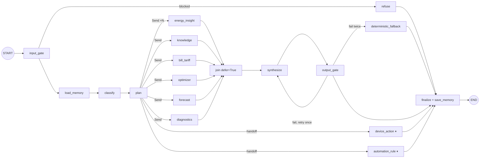

# 03 — LangGraph Design

Target: `langgraph` 1.x (repo pins `1.2.12`), `langgraph-checkpoint-postgres`, Python 3.12.

## 1. Pattern choice

| Pattern | Use it for | Why / why not |
|---|---|---|
| **Supervisor + subgraphs (hierarchical)** ✅ | Chat path | Central control of budget, gates and synthesis. Each agent is isolated and testable |
| **Map-reduce with `Send`** ✅ | Multi-intent questions, batch per household | Runs agents in parallel; reducer merges `AgentResult`s |
| **Interrupt / human-in-the-loop** ✅ | Device Action, Rule activation, ticket escalation | Pauses on a durable checkpoint and resumes with `Command(resume=...)` |
| **Swarm / free handoffs between agents** ❌ | — | Agents passing control to each other is hard to bound, budget and audit. Agents return to the supervisor; only the supervisor dispatches |
| **ReAct tool loop** ⚠️ limited | Knowledge Agent query refinement, Diagnostics only | Allowed with `max_steps ≤ 3` and a closed tool set. Everything else uses a deterministic plan |
| **Prebuilt `langgraph-supervisor` (`create_supervisor`)** ⚠️ | Prototypes | It routes with an LLM on every turn. Volta's rule-first routing saves those tokens, so write the supervisor as a normal `StateGraph` |

## 2. Top-level graph



Action and rule agents are **exclusive** routes. A message that mixes "explain" and "do" runs the explain part
first and offers the action as a follow-up proposal. It never runs the action in parallel with other agents.

## 3. State

```python
# orchestration/state.py
import operator
from typing import Annotated, Literal, TypedDict
from langgraph.graph.message import add_messages

class SupervisorState(TypedDict, total=False):
    # input (already masked at the edge)
    messages: Annotated[list, add_messages]   # thread history, trimmed by load_memory
    question: str
    request_id: str
    # gates
    input_flags: InputFlags                   # injection_score, pii_map_id, lang, length
    blocked_reason: str | None
    # routing
    intents: list[Intent]
    classification_method: Literal["rules", "classifier", "llm", "default"]
    plan: Plan
    # fan-in: reducer appends results from parallel branches
    results: Annotated[list[AgentResult], operator.add]
    # output
    draft: FinalAnswer | None
    output_checks: OutputChecks | None
    attempts: int
    final: AssistantResponse | None
    usage: Annotated[list[TokenUsage], operator.add]
```

Keep state **small and typed**. Tool payloads stay inside the agent subgraph and only `AgentResult` crosses back.
That keeps checkpoints small, which matters with Postgres checkpointing on every super-step.

## 4. Runtime context (no globals)

Extends today's `AssistantRuntime`. Bound per request at the service layer, never visible to the LLM.

```python
@dataclass(frozen=True)
class VoltaRuntime:
    user_id: str
    household_id: str
    tenant_id: str
    roles: frozenset[str]
    locale: str
    clock: Clock
    gateways: Gateways            # EnergyDataGateway, KnowledgeGateway, ... (request-scoped, single-flight)
    llm: ModelRegistry            # role -> StructuredLLM
    budget: BudgetTracker         # tokens/ms remaining; nodes debit it
    flags: FeatureFlags
    vault: PiiVaultClient
```

## 5. Dispatch with `Send`

```python
from langgraph.types import Send

def dispatch(state: SupervisorState) -> list[Send] | str:
    plan = state["plan"]
    if plan.exclusive:                       # device_action / automation_rule
        return plan.exclusive.value          # node name
    return [
        Send(call.agent.value, {"call": call, "question": state["question"]})
        for call in plan.agents
    ]

g.add_conditional_edges("plan", dispatch, [a.value for a in AgentName])
```

Each agent node receives only its `AgentCall`, not the full supervisor state. That is least-privilege for context.

## 6. Agents as subgraphs

Each agent package exposes a compiled subgraph with its **own** state, wrapped in an adapter node that maps
`AgentCall` → subgraph input → `AgentResult`.

```python
# agents/energy_insight/node.py
from langgraph.runtime import Runtime

ENERGY_GRAPH = build_energy_insight_graph()       # compiled once at import

async def energy_insight(inp: AgentInput, runtime: Runtime[VoltaRuntime]) -> dict:
    ctx = runtime.context
    with ctx.budget.slice(inp["call"].budget_tokens, inp["call"].deadline_ms) as b:
        try:
            out = await asyncio.wait_for(
                ENERGY_GRAPH.ainvoke({"call": inp["call"]}, context=ctx),
                timeout=b.deadline_s,
            )
            return {"results": [out["result"]], "usage": [out["usage"]]}
        except asyncio.TimeoutError:
            return {"results": [AgentResult.timeout(AgentName.ENERGY_INSIGHT)]}
```

Why the adapter instead of adding the subgraph directly as a node: a different state schema, a per-agent deadline,
and a failure becomes a typed `AgentResult` instead of an exception that kills sibling branches.

## 7. Building the supervisor

```python
from langgraph.graph import StateGraph, START, END
from langgraph.types import RetryPolicy, CachePolicy

def build_supervisor(checkpointer, store, cache):
    g = StateGraph(SupervisorState, context_schema=VoltaRuntime)

    g.add_node("input_gate", input_gate)
    g.add_node("load_memory", load_memory)
    g.add_node("classify", classify,
               cache_policy=CachePolicy(ttl=300))                      # same normalized question -> same intents
    g.add_node("plan", plan)
    for name, fn in AGENT_NODES.items():
        g.add_node(name, fn, retry_policy=RetryPolicy(max_attempts=2))  # transient I/O only
    g.add_node("join", join, defer=True)                                # waits for every Send branch
    g.add_node("synthesize", synthesize, retry_policy=RetryPolicy(max_attempts=2))
    g.add_node("output_gate", output_gate)
    g.add_node("deterministic_fallback", deterministic_fallback)
    g.add_node("refuse", refuse)
    g.add_node("finalize", finalize)

    g.add_edge(START, "input_gate")
    g.add_conditional_edges("input_gate", route_after_input, ["refuse", "load_memory"])
    g.add_edge("load_memory", "classify")
    g.add_edge("classify", "plan")
    g.add_conditional_edges("plan", dispatch, [*AGENT_NODES, "refuse"])
    for name in PARALLEL_AGENTS:
        g.add_edge(name, "join")
    for name in EXCLUSIVE_AGENTS:
        g.add_edge(name, "finalize")
    g.add_edge("join", "synthesize")
    g.add_edge("synthesize", "output_gate")
    g.add_conditional_edges("output_gate", route_after_output,
                            ["synthesize", "deterministic_fallback", "finalize"])
    g.add_edge("deterministic_fallback", "finalize")
    g.add_edge("refuse", "finalize")
    g.add_edge("finalize", END)

    return g.compile(checkpointer=checkpointer, store=store, cache=cache)
```

Compile **once per process** (as today with `lru_cache`) and reuse for every request.

## 8. Persistence

| Concern | Choice | Notes |
|---|---|---|
| Checkpointer | `AsyncPostgresSaver` (`langgraph-checkpoint-postgres`) on a **dedicated** Postgres DB/schema | Not the OLTP auth DB. Separate pool. Run `await saver.setup()` from a migration job, not on boot |
| Thread id | `f"{user_id}:{household_id}:{conversation_id}"` | Action proposals use `f"action:{proposal_id}"` as today |
| Durability | `durability="async"` for chat, `"sync"` for action/rule graphs | Chat can lose the last step on a crash. Actions cannot |
| Retention | TTL job deletes chat checkpoints after N days (e.g. 30) | Keeps the table small. Long-term facts go to the Store |
| Store | `AsyncPostgresStore` with pgvector index | Long-term user memory ([07](./07-memory-rag-caching.md)) |
| Node cache | Redis-backed cache for `classify` and deterministic nodes | Short TTL only. Live data changes every tick |

Fix first: `actions/graph.py` uses `MemorySaver`. With more than one API replica, the confirm request can land on
a replica that never saw the interrupt, and a restart drops every pending proposal.

## 9. Human-in-the-loop (interrupt) contract

```python
from langgraph.types import interrupt, Command

async def confirm_node(state: ActionState, runtime: Runtime[ActionRuntime]):
    answer = interrupt({
        "type": "confirm_action",
        "proposal_id": state["proposal_id"],
        "summary": render_summary(state),        # deterministic text, not LLM
        "checks": state["checks"],
        "expires_at": state["expires_at"],
    })
    return {"confirmed": answer.get("confirmed") is True,
            "confirmed_by": answer.get("user_id")}

# API: POST /v2/actions/{proposal_id}/confirm
await action_graph.ainvoke(
    Command(resume={"confirmed": True, "user_id": user.id}),
    config={"configurable": {"thread_id": f"action:{proposal_id}"}},
    context=runtime,
    durability="sync",
)
```

Rules: the resume handler re-checks ownership and expiry, the graph re-loads facts and re-runs safety **after**
resume, and a proposal can be resumed only once (idempotency key in Postgres).

## 10. Streaming

```python
async for mode, chunk in graph.astream(
        inputs, config, context=runtime,
        stream_mode=["custom", "messages", "updates"], subgraphs=True):
    ...
```

| Stream | Sent to client as | Use |
|---|---|---|
| `custom` (via `get_stream_writer()`) | `event: status` | "Checking battery…", "Reading your bill…" progress |
| `messages` | `event: token` | Tokens **only from the `synthesize` node** (filter by `langgraph_node` metadata) |
| `updates` | `event: trace` (debug only) | Node-level trace in dev |
| Final | `event: final` | `AssistantResponse` envelope after the output gate passed |

Streaming and output guardrails conflict: a token already on screen cannot be pulled back. Use this policy:
- Stream tokens, but the **final envelope is authoritative**. If the output gate fails, send `event: replace`
  with the fallback answer and the UI swaps the text.
- For high-risk intents (actions, billing amounts, safety advice) **buffer** and send only after the gate passes.

## 11. Limits that keep it bounded

| Limit | Value | Where |
|---|---|---|
| `recursion_limit` | 25 | `config` |
| Agents per plan | ≤ 4 | planner |
| ReAct steps inside an agent | ≤ 3 | agent subgraph |
| Output-gate retries | 1 | `route_after_output` |
| Per-agent deadline | 2.5 s default, 6 s for knowledge | `AgentCall.deadline_ms` |
| Total request deadline | 8 s, then return partial + warning | service layer |
| Token budget per request | e.g. 6k in / 1k out | `BudgetTracker` (edge enforces the daily cap) |

## 12. Code layout

```
backend/app/agents_platform/
├── orchestration/
│   ├── state.py  runtime.py  supervisor.py  dispatch.py  synthesize.py  finalize.py
│   └── gates/  input_gate.py  output_gate.py  budget.py  freshness.py
├── agents/
│   ├── energy_insight/   graph.py  node.py  prompts/  schemas.py  evals/
│   ├── knowledge/        ...
│   ├── bill_tariff/      ...
│   ├── forecast/         ...
│   ├── optimizer/        ...
│   ├── device_action/    (moved from assistant/actions)
│   ├── automation_rule/
│   ├── diagnostics/
│   └── onboarding/
├── ambient/  monitor.py  recommender.py  reporter.py  consumers.py
├── guardrails/  pii.py  injection.py  groundedness.py  policy.py
└── infra/  checkpointer.py  store.py  cache.py  registry.py  telemetry.py
```

Move code in steps (see [11](./11-roadmap-suggestions.md)). `modules/assistant` stays as the v1 API until v2 is
at parity on the eval suite.

## 13. Testing graphs

- **Unit**: every node is a plain async function. Call it with a fake `Runtime` and state dict.
- **Graph**: compile with `InMemorySaver` and fake `StructuredLLM` (pattern already in `tests/assistant_helpers.py`).
- **Interrupt**: invoke until `__interrupt__`, assert payload, resume with `Command`, assert publisher calls.
- **Parallelism**: inject slow fake agents to assert deadlines produce `timeout` results without blocking siblings.
- **Trajectory**: assert the node sequence + agents dispatched for each eval case ([05](./05-evals.md)).
