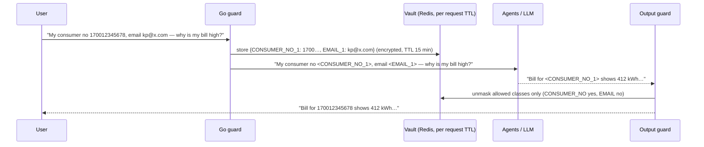

# 04 — Guardrails, Gates & Masking

A **guardrail** inspects content. A **gate** is a pass/fail decision point in the flow that may use
guardrails, policy or data checks. Every gate emits a structured log `{gate, decision, reason, latency_ms}`
and a metric, so you can see exactly where requests are stopped.

## 1. The ten gates

| Gate | Where | Checks | On fail | Exists today? |
|---|---|---|---|---|
| **G0 Identity & tenant** | Go edge | JWT signature/expiry, user active, household ownership, role | 401/404, no graph run | Yes (FastAPI deps) → move JWT verify to edge, keep ownership in Python |
| **G1 Input guard** | Go fast-path + Python node | Length, charset/encoding tricks, injection/jailbreak score, PII detect + mask, language, abuse/toxicity | Refuse (template) or continue with flags | Partial (length, jailbreak regex) |
| **G2 Scope & intent** | `classify` / `plan` | In-domain? Intent allowed for this user/plan tier? Exclusive routes (action) | Out-of-scope template | Yes (`out_of_scope`, `device_control`) |
| **G3 Budget** | Edge + `BudgetTracker` | Per-request tokens/time, per-user daily, per-tenant monthly | Degrade to deterministic or 429 | No |
| **G4 Data freshness** | Agent `analyze` | Telemetry age vs threshold, data quality flags | Low confidence + warning, or "no data" | Yes (`freshness.py`) |
| **G5 Tool authZ** | Tool wrapper | Agent allowed to call this tool? Scope bound to runtime household? Read vs write | Tool returns `forbidden`, logged as a security event | Implicit (closure binding) → make explicit |
| **G6 Action safety** | Action agent + Go executor | RBAC, kill switch, reserve SOC, critical devices, inverter capacity, duplicate, freshness | Reject with reasons | Yes (`safety.py`) |
| **G7 Human confirm** | `interrupt` | Explicit user confirmation, TTL, re-check after resume, single use | No command | Yes (MemorySaver → Postgres) |
| **G8 Output guard** | Before final event | Schema, numeric grounding, citations, policy, PII leakage, tone/length | Retry once → deterministic fallback | Partial (schema only) |
| **G9 Release gate** | CI/CD | Eval thresholds, red-team pass rate, cost/latency regressions | Block merge/deploy | No ([05](./05-evals.md)) |

## 2. Input guardrails (G1)

Two tiers, so that most traffic pays microseconds and only suspicious traffic pays model latency.

| Tier | Runs in | Latency | Checks |
|---|---|---|---|
| **Fast path** | Go guard service (or Go edge middleware) | < 1 ms | Max length, Unicode normalisation (NFKC), zero-width/homoglyph stripping, regex + Aho-Corasick for known jailbreak phrases ("ignore previous", "system prompt", role-play markers), PII patterns (see §4), rate of retries |
| **Slow path** | Python guard node, **only if** fast path score is in the grey zone or the intent is high-risk | 20–150 ms | Small classifier (e.g. a prompt-injection classifier model, or Llama Guard-class safety model, served on CPU/GPU) or the `router` LLM with a structured `InjectionVerdict` |

Decision table:

| Fast score | Intent | Action |
|---|---|---|
| Low | Any read | Continue, skip slow path |
| Grey | Read | Slow path. If injection → answer with facts only, mark `untrusted=true` (no tools beyond the plan) |
| Any | Action / rule | Always slow path. Injection → reject (already `prompt_injection` in `safety.py`) |
| High | Any | Refuse with template, log security event, count toward abuse limit |

### Indirect injection (RAG and uploads)

Documents and bills are untrusted. Defences:
1. At **ingest**: scan chunks for instruction-like text and store `risk_score` on the chunk. Quarantine high-risk docs from shared scope.
2. At **prompt build**: wrap retrieved text in `<document id=… trust="untrusted">…</document>` and state in the system prompt that document content is data, not instructions.
3. **Capability separation**: the Knowledge Agent has **no write tools and no action handoff**. Even a successful
   injection in a manual cannot trigger a device command, because only the supervisor can route to the Action Agent
   and only from the user's own message.

## 3. Output guardrails (G8)

Ordered from cheapest to most expensive. Stop at the first hard fail.

| # | Check | Type | Detail |
|---|---|---|---|
| 1 | Schema | Deterministic | Pydantic `FinalAnswer`. Already in place |
| 2 | **Numeric grounding** | Deterministic | Extract every number + unit from the answer and match it against `facts[]` (with rounding tolerance and unit conversion kW↔W, %, ₹). Any unknown number is a fail. This is the most valuable check for Volta, because it enforces "LLM explains, code calculates" |
| 3 | Claim → fact links | Deterministic | Each `claims[i].fact_ids` must exist in results |
| 4 | Citations | Deterministic | Knowledge answers must cite chunk ids that were retrieved in this request |
| 5 | Forbidden statements | Deterministic | "I turned on/off…", "I have scheduled…" unless the action graph actually published. Safety advice blacklist (e.g. "open the inverter", "bypass the breaker") |
| 6 | PII leakage | Deterministic | No unmasked email/phone/consumer no./GPS/ids. Placeholder tokens that were not allowed to unmask are stripped |
| 7 | Data-time & confidence | Deterministic | `data_time` stamped from telemetry, stale → confidence low (already in `finalize`) |
| 8 | Semantic faithfulness | Small LLM judge | **Only** for knowledge answers and multi-agent syntheses, and only when 1–7 pass. Async/sampled for low-risk intents |

On fail: one regeneration with the failure reason added to the prompt, then the deterministic fallback
(already implemented in `domain/answers.py`).

## 4. PII masking — reversible tokenization vault

### What counts as sensitive in Volta

| Class | Examples | Policy |
|---|---|---|
| Direct identifiers | Name, email, phone, address | Never to LLM. Mask in input, never in facts |
| Utility identifiers | Consumer/account number, meter number, bill number | Mask. Unmask only in UI if the user asked for it |
| Location | GPS coordinates, street | Never to LLM; city/region is enough (current policy) |
| Internal ids | `user_id`, `household_id`, proposal ids | Never to LLM (current policy) |
| Secrets | API keys, tokens, passwords typed into chat | Block + drop from logs, warn the user |
| Financial | UPI id, bank account, card | Block |

### Flow

| Design point | Choice |
|---|---|
| Detection | Go: regex + checksum validators (Indian mobile, email, PAN, Aadhaar-like 12-digit with Verhoeff, IFSC, consumer-number patterns per DISCOM). Python slow path: NER (e.g. Presidio-style recognizers) for names/addresses in documents |
| Tokens | Typed, stable within a request: `<EMAIL_1>`. Models handle these well and keep sentence structure |
| Vault | Redis hash per `request_id`, AES-GCM encrypted values, TTL. Never persisted to checkpoints. Checkpoints store the masked text |
| Unmask policy | Per class + per channel (UI yes, email notification maybe, logs never) |
| Logs and traces | Same masker runs as a log/trace processor. LangSmith/Langfuse receive masked text only |
| Documents | Mask at ingest: chunk text stored masked for the embedding/LLM path. Original file in object storage with restricted access |

## 5. Policy engine

Put allow/deny rules that change often outside the code:

| Policy | Example |
|---|---|
| Intent × plan tier | Free tier: no Optimizer, no what-if |
| Tool × agent | Knowledge Agent: `search_knowledge` only |
| Action × device class | Never `off` for `critical`; `on` blocked when SOC < reserve + margin |
| Budget × tier | Daily tokens per user |

Use OPA (Rego) or Cedar, evaluated by the Go edge and the Go executor (both have native Go SDKs), with a Python
client for agent nodes. Policies are versioned in git and tested in CI like code.

## 6. Abuse and cost guardrails

- Token budgets in Redis (GCRA / sliding window) at the edge: requests/min **and** tokens/day.
- Repeated guard failures from one user → progressive cool-down.
- Max output tokens per role. Max agents per plan. Recursion limit.
- Kill switch per feature flag: `ai.llm.enabled`, `ai.actions.enabled`, `ai.agent.<name>.enabled`. Off → deterministic answers.

## 7. Where each guard runs

| Guard | Go | Python | LLM |
|---|---|---|---|
| Length / normalisation / regex jailbreak | ✅ | | |
| PII detect + mask + vault | ✅ | NER for documents | |
| Injection classifier (grey zone) | | ✅ | small model |
| Scope / intent | | ✅ rules | router fallback |
| Budget & rate | ✅ | debit in nodes | |
| Tool authZ | | ✅ wrapper | |
| Action safety | ✅ executor re-check | ✅ `safety.py` | |
| Numeric grounding, citations, forbidden claims | | ✅ | |
| Faithfulness judge | | ✅ | judge (sampled) |
| Log/trace redaction | ✅ | ✅ | |
