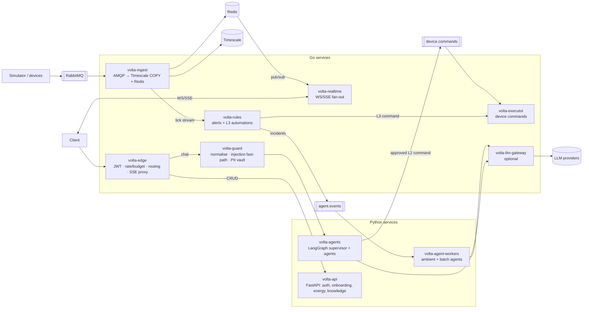

# 06 — Go Performance Plane

## 1. The rule for choosing Go vs Python

Use **Go** where the work is high-volume, long-lived, concurrency-heavy and does not need the Python AI
ecosystem. Keep **Python** where the work is LLM orchestration, ML, or reuses the existing domain code.

An LLM call takes 300 ms to several seconds. Rewriting a node that waits on it in Go saves almost nothing.
The gains come from the layers that run **per tick, per connection, per request before the LLM, or per command**.

| Layer | Volume / shape | Go? | Expected gain vs FastAPI/Python |
|---|---|---|---|
| Telemetry ingest worker | Every tick × every home, 24/7 | ✅ **Yes, first** | Large: batched `COPY` into Timescale, Redis pipelining, no GIL, far less CPU and memory per message |
| Realtime gateway (WS/SSE fan-out) | Long-lived connections × Redis pub/sub | ✅ **Yes** | Large: goroutine per connection is cheap, so many more concurrent sockets per pod |
| Edge / API gateway | Every request | ✅ Yes | Medium: JWT verify, rate limit, budget, routing, request coalescing in < 1 ms |
| Guard fast-path (normalise, regex, PII mask, vault) | Every chat message + every log line | ✅ Yes | Medium: compiled regex/Aho-Corasick, no model, sub-millisecond |
| Rule engine (alerts + L3 automations) | Every tick × every rule | ✅ **Yes** | Large: in-memory per-household state, evaluates thousands of rules per ms |
| Device command executor | Every command, safety-critical | ✅ Yes | Correctness more than speed: static types, single binary, strict state machine, easy to audit |
| LLM gateway (routing, failover, keys, budgets, caching) | Every LLM call | ✅ Optional | Low latency proxy, central keys and budgets. Can adopt an existing Go gateway instead of writing one |
| Scheduled fan-out (daily per household) | Batch | ⚠️ Either | Dispatching is cheap in either; agents still run in Python |
| LangGraph supervisor + agents | Per chat | ❌ **Python** | LangGraph is Python/JS. Go has LLM client libraries but no LangGraph equivalent with checkpoints and interrupts |
| Analytics, tariff maths, safety evaluator | Per request | ❌ Python (for now) | Already written and tested. Fast enough (ms). The executor re-checks critical rules in Go anyway |
| RAG embedding / rerank / ML forecast | Per request / batch | ❌ Python | Model ecosystem |
| Auth, onboarding CRUD | Low volume | ❌ Keep FastAPI | No benefit worth a rewrite |

## 2. Target topology



## 3. Service designs

### 3.1 `volta-ingest` (replace `app/workers/ingest.py`)

| Concern | Design |
|---|---|
| Consume | `amqp091-go`, prefetch 500–2000, manual ack |
| Validate | Same rules as `docs/telemetry_ingest.md` (energy balance, import/export exclusivity). Port the validator and test it against the **same fixtures** as the Python version (golden-file parity test) |
| Store | Buffer up to N rows or T ms (e.g. 1000 / 200 ms) → `pgx.CopyFrom` into a staging table → `INSERT … ON CONFLICT` upsert. Ack the batch only after commit |
| Live | Redis pipeline: `SET volta:live:<home>` + `PUBLISH volta:live:ch:<home>` |
| Rules feed | Publish the normalised tick to an internal stream (NATS JetStream or RabbitMQ stream) for `volta-rules` |
| Back-pressure | Bounded channels. When the DB is slow, stop acking so the broker holds messages |
| Observability | Prometheus: lag, batch size, commit latency, invalid ticks by reason |

Migration: run both workers on separate queues in shadow mode, compare rows, then switch.

### 3.2 `volta-realtime` (replace FastAPI WS in `energy/ws.py` + `notifications/ws.py`)

- `coder/websocket` (or `gorilla/websocket`) + SSE.
- One Redis pub/sub subscription **per household per pod** (not per socket), fanned out to local sockets.
- Auth: verify JWT locally (public key / JWKS), check `household` claim or call a cached ownership endpoint.
- Heartbeats, per-connection send buffers, slow-consumer drop.
- Also carries agent streams for ambient notifications (`event: alert`, `event: recommendation`).

### 3.3 `volta-edge`

| Feature | Detail |
|---|---|
| Routing | `/v2/assistant/*` → guard → agents; others → FastAPI |
| AuthN | JWT verification (same keys as `core/security.py`), propagate `X-User-Id`, `X-Request-Id` over mTLS |
| Limits | Redis GCRA: requests/min per user + tokens/day per user/tenant (agents report usage back via a header or event) |
| SSE proxy | Pass-through streaming from the agent service with flush, timeouts, client-disconnect cancel propagation |
| Coalescing | `singleflight` for identical in-flight GETs (e.g. dashboard polling `/energy/live`) |
| Option | Instead of a custom service, use Envoy / Kong / Traefik with Go plugins or OPA. Write custom Go only for budget logic |

### 3.4 `volta-guard`

gRPC: `Inspect(InspectRequest) → InspectResponse{masked_text, pii_map_id, flags, score}` and `Unmask(...)`.
Holds the compiled pattern sets, reloads them from config without restart, runs in < 1 ms p99 for 500-char input.
Also used as a **log redaction** library (the same Go package is imported by every Go service).

### 3.5 `volta-rules` (alerts + L3 automations)

- Keeps per-household rolling state in memory (last N ticks, debounce timers, rule state machines), sharded by
  `household_id` hash across pods.
- Evaluates the alert conditions now in `domain/alerts.py` (port with parity tests) and user automation DSL
  produced by the Automation Rule Agent.
- Emits **state transitions** only (`battery_below_reserve: false → true`), never per-tick noise. Ambient agents
  consume those, so the LLM sees maybe dozens of events per home per day instead of tens of thousands of ticks.

### 3.6 `volta-executor`

```
RECEIVED → VALIDATED → POLICY_OK → DISPATCHED → ACKED | FAILED | EXPIRED
```

- Idempotency key = `command_id`. Exactly-once effect via an outbox table + unique constraint.
- Re-checks: kill switch, household control enabled, device controllable, critical-off ban, SOC ≥ reserve for
  `on`, rate limit per device, command TTL. These are defence in depth on top of `safety.py`.
- Adapters: simulator (today, `device_commands`), later MQTT / Modbus-TCP / vendor cloud APIs.
- Every transition is written to an append-only audit table.

### 3.7 LLM gateway (optional)

Central place for provider keys, failover, per-tenant budgets, response caching and usage accounting. Choose:
- Adopt an open-source Go LLM gateway (e.g. Bifrost) or Envoy AI Gateway, **or**
- keep LangChain's `.with_fallbacks()` + a Python budget tracker (today's approach) until volume justifies it.

If you add it, LangChain talks to it as an OpenAI-compatible endpoint (`AI_LLM_BASE_URL`), so agent code does not change.

## 4. Contracts between Go and Python

| Link | Protocol | Why |
|---|---|---|
| Edge → Agents (chat) | HTTP/2 + SSE (simple) or gRPC server-stream | Streaming tokens; SSE is easy to proxy and debug |
| Guard ↔ Agents | gRPC (protobuf) | Typed, low latency |
| Agents → Executor | Queue (`device.commands`) with protobuf/JSON-schema payload | Decoupled, durable, auditable |
| Rules → Ambient agents | Queue (`agent.events`) | Back-pressure, retries, DLQ |
| Shared schemas | `proto/` repo folder → generated Go + Python (`buf`) | One source of truth for `DeviceCommand`, `Tick`, `Incident`, `InspectResponse` |

## 5. What not to do

- Do not rewrite LangGraph nodes in Go to "go faster". The LLM dominates latency.
- Do not split into many Go microservices on day one. Start with **ingest** and **realtime** (biggest gains,
  clear boundaries), then the executor, then edge/guard.
- Do not duplicate business rules without parity tests. Every rule ported to Go (validation, alerts, safety
  re-checks) runs against shared JSON fixtures in both languages in CI.

## 6. Benchmark before and after

Measure on your own hardware with your tick shape before claiming numbers:

| Benchmark | Tool | Metric |
|---|---|---|
| Ingest | Publish synthetic ticks at 1×, 10×, 100× the current rate | Sustained msgs/s, p99 commit latency, CPU, RSS |
| Realtime | k6 / `tsung` with 5k–50k idle + active sockets | Sockets per pod, p99 fan-out delay, memory per socket |
| Edge | `wrk2` / k6 on auth + rate-limited route | p99 overhead added by edge |
| Guard | Go `testing.B` on 50/500/2000-char inputs | ns/op, allocations |

Keep the numbers in this doc once measured. They justify (or reject) each Go migration.
