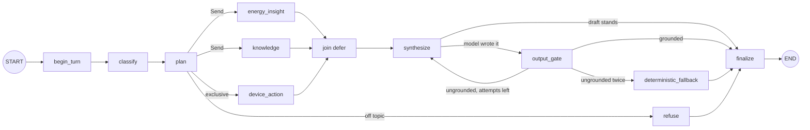

# 14 — Phase 1 Implementation

Status: **done** (2026-11-11). All Python, FastAPI and LangGraph. The v1 endpoints are untouched and still live. The two items
left open at the time, relocating `assistant/actions/` and a real-model parity check, were closed on 2026-11-12: see
[15 §9](./15-phase2-implementation.md). When Phase 1 was completed 474 tests passed with Postgres and Redis available (462 pass
and 12 skip without them); the current figures are in the [tracker](./13-progress-tracker.md).

Design this implements: [02](./02-agent-catalog.md), [03](./03-langgraph-design.md), [05 §4](./05-evals.md).

## 1. What changed

| # | Item | Where | One-line behaviour |
|---|---|---|---|
| 1.1 | Supervisor | [orchestration/](../../backend/app/agents_platform/orchestration/) | Classify, plan, dispatch agents in parallel with `Send`, `join(defer=True)`, one synthesizer, output gate, finalize |
| 1.2 | Energy Insight agent | [agents/energy_insight.py](../../backend/app/agents_platform/agents/energy_insight.py) | The v1 tools, analytics, freshness and projection, returning facts instead of an answer |
| 1.3 | Knowledge agent | [agents/knowledge.py](../../backend/app/agents_platform/agents/knowledge.py) | The Phase 0 indexed retrieval, returning passages as citations, or a deterministic "not in your documents" |
| 1.4 | Device Action agent | [agents/device_action/agent.py](../../backend/app/agents_platform/agents/device_action/agent.py) | Exclusive route. Proposes through the existing action workflow, never sends a command |
| 1.5 | Trajectory evals, streaming | [evals/](../../backend/app/agents_platform/evals/), [api/router.py](../../backend/app/agents_platform/api/router.py) | 42 cases and 56 turns asserting route, agents, node path and model calls; SSE `status` and `final` events |
| 1.6 | Thread memory, regeneration | [memory.py](../../backend/app/agents_platform/orchestration/memory.py), [conversations.py](../../backend/app/agents_platform/conversations.py) | Follow-ups inherit the previous topic; an ungrounded answer is regenerated once, with the failing numbers listed |

New API (v1 is unchanged):

| Method | Path | Notes |
|---|---|---|
| POST | `/v2/assistant/me/ask` | Caller's primary home (`?household_id=` optional) |
| POST | `/v2/assistant/{household_id}/ask` | A home the caller owns |
| POST | `/v2/assistant/me/ask/stream` | Same, as server-sent events |
| POST | `/v2/assistant/{household_id}/ask/stream` | Same, for a named home |

Migration `202611110001` adds `assistant_conversations`. Refactors to shared v1 code were behaviour-neutral (all 179 v1
assistant tests passed unchanged): [finalize.py](../../backend/app/modules/assistant/domain/finalize.py) and
[graph/routing.py](../../backend/app/modules/assistant/graph/routing.py) hold logic that v1 and v2 now share.

## 2. How a question flows



| Route | Planner decides | Model calls |
|---|---|---|
| `single` | One agent covers every intent | 1 answer call (0 if the agent's own draft stands) |
| `multi` | e.g. `document` + `battery`: Knowledge and Energy run **in parallel** | Still 1 answer call, over the merged facts |
| `exclusive` | `device_control`: only Device Action runs, other intents are dropped (as v1 does) | 0 |
| `refusal` | `out_of_scope`: no agent runs | 0 answer calls |

Classification is the v1 cascade, plus memory: **rules** (0 tokens) → **follow-up from memory** (0 tokens) → **router model**.

## 3. Design decisions worth knowing

1. **Agents gather facts. The synthesizer writes the answer.** The two read-only agents run the v1 pipeline cut off after
   `analyze` (the v1 nodes, unchanged) and return `facts`, `analytics`, `freshness`, `citations` and a deterministic `draft`.
   One synthesizer then makes the single model call and owns the grounding check, the regeneration and the fallback, for
   every plan. The alternative, each agent answering and the supervisor merging, costs 2–3 calls for a compound question where
   v1 spent 1, and would put the output gate in three places. A one-agent question costs exactly what it cost in v1.
2. **An agent is a failure boundary.** `make_agent_node` wraps every agent in a deadline and a catch-all. A timeout or a crash
   becomes a typed `AgentResult` with no facts, the sibling agents still finish, and the answer carries a warning and a
   confidence capped at `medium`. If nothing usable returns, the answer says so and no tokens are spent.
3. **A checkpointed thread outlives a question, so per-turn state must be reset.** Reducer keys (`results`, `warnings`, …)
   would keep appending across questions. `begin_turn` resets every per-turn key with `Overwrite`. A test fails if a key is
   added to the state and not classified as persistent or reset, and a mutation check confirmed it catches a missing reset.
4. **Memory keeps the earlier *question*, never its *answer*.** A follow-up is routed from the previous turn's intents and the
   agents get "why? (follow-up to: …)". Facts are always re-read live, so an old number can never be repeated as current.
   Only a bare "why", "and tomorrow?", "tell me more", "what about the washing machine?" count. A question that names a domain word
   ("and the grid?"), follows an action or a refusal, or is long is **not** treated as a follow-up.
5. **The server issues conversation ids.** A client cannot invent one or resume somebody else's. An unknown id and a foreign
   id both return the same `404 conversation_not_found`, so ids cannot be probed. The LangGraph thread id also embeds the user
   and home: `chat:{user}:{home}:{id}`.
6. **A device action is still only a proposal.** The agent calls the existing `ActionService.propose`, which parses, loads facts,
   runs the deterministic safety checks and pauses on a durable `interrupt`. The user confirms through the existing
   `/assistant/actions/{id}/confirm`. The Phase 0 lifecycle (2-minute deadline, single use, replay guard, audit) is unchanged. No
   model is involved, and a test asserts that asking publishes nothing.
7. **Streaming opens its own database session.** With this FastAPI version, a `get_db` session is committed and closed before a
   streamed body runs, so anything written during the stream (a proposal row) would be lost. The stream endpoint opens a
   session scope that lives until the stream ends and commits there. A bad conversation id is raised before the first byte, so
   it is a plain 404, not a broken stream.
8. **Tokens are not streamed.** The answer is a five-field object and the output gate may replace it. Words shown and then
   pulled back are worse than waiting, so the client gets progress (`status`) and then the checked answer once (`final`).

## 4. The output gate and the regeneration

`output_gate` checks every number in a model-written answer against the exact facts the model was shown (the same payload the
prompt used, rebuilt by the same function). `AI_GROUNDING_MODE` behaves as in Phase 0.

| Situation | Result |
|---|---|
| Grounded | Return it |
| Ungrounded, `attempts < AI_ANSWER_MAX_ATTEMPTS` | Regenerate once. The prompt lists the failing numbers and asks for a rewrite using only values in the facts |
| Ungrounded again | `deterministic_fallback`: the agents' verified drafts, with the "Verified summary shown" note |
| `observe` mode | Keep the answer, record the finding, no retry |
| Model error | The agents' drafts with a "generated without the AI model" note |

`AI_ANSWER_MAX_ATTEMPTS=1` turns the retry off. The cap is enforced in the graph and a mutation check confirmed that removing it
fails tests. This closes the Phase 0 follow-up "grounding failure falls back without a retry" **for v2**. v1 still falls back
without a retry.

## 5. API contract

`SupervisorResponse` is a superset of v1's `AssistantResponse`, so a client can switch by changing the path. New fields:
`conversation_id`, `route`, `agents` (name, status, latency, confidence for each), and `proposal` (a pending device action).
For the same data and the same fake model, v2 returns v1's `answer`, `intents`, `tools_used`, `analytics_used`, `confidence` and
token usage for five question types, and the same answer with no telemetry and on a document gap.

```
event: status
data: {"event":"status","stage":"agent_started","message":"Checking your home's energy data…","agent":"energy_insight"}

event: final
data: { …the full SupervisorResponse… }
```

Stages: `understanding`, `agent_started` (one per agent), `synthesizing`. A failure after the stream starts arrives as
`event: error` with a code (`assistant_timeout` or `assistant_error`), and the stream ends.

## 6. Configuration

All keys are in [backend/.env.example](../../backend/.env.example).

| Setting | Default | Notes |
|---|---|---|
| `AI_SUPERVISOR_DEADLINE_SECONDS` | 30 | Whole request. Over it: `504 assistant_timeout` (or an `error` event) |
| `AI_ENERGY_AGENT_DEADLINE_SECONDS` | 8 | Keep above `AI_TOOL_TIMEOUT_SECONDS`: the agent waits on parallel tools |
| `AI_KNOWLEDGE_AGENT_DEADLINE_SECONDS` | 10 | Includes the embedding call |
| `AI_DEVICE_ACTION_AGENT_DEADLINE_SECONDS` | 8 | |
| `AI_ANSWER_MAX_ATTEMPTS` | 2 | 2 = one regeneration. 1 = none |
| `AI_MEMORY_WINDOW_TURNS` | 4 | Earlier questions read to resolve a follow-up. Up to 10 are stored per thread |
| `AI_CONVERSATION_RETENTION_DAYS` | 30 | Idle conversations are deleted with their checkpoints |

## 7. Operations

| Task | Command |
|---|---|
| Create the conversations table | `alembic upgrade head` (run by the compose `migrate` job) |
| Delete idle conversations and their memory (compose runs it hourly, beside the action maintenance) | `python -m app.agents_platform.maintenance` |
| Run trajectory evals (CI runs it) | `python -m app.agents_platform.evals --report out.json` |
| Run the Postgres memory test | `TEST_POSTGRES_URL=postgresql+asyncpg://… pytest tests/test_supervisor_postgres.py` |

Maintenance deletes a conversation's checkpoints first and its row second, so a crash between them leaves a row that the next run
retries, never checkpoints that nothing points to.

New metrics: `volta_agent_runs_total{agent,status}`, `volta_agent_latency_seconds{agent}`,
`volta_supervisor_requests_total{route,path}`, `volta_supervisor_regenerations_total{outcome}` (`recovered` | `fell_back`).
The Phase 0 grounding and token metrics are reused. Every request logs one `supervisor …` line with route, agents, method,
fallback, confidence, tokens and latency. LangGraph runs carry `request_id`, `conversation_id` and `household_id` metadata.

## 8. Tests

| File | What it pins |
|---|---|
| `test_supervisor_graph.py` (28) | Parallelism (timed), one model call per answer, plan order, exclusive route, refusal, timeout and crash isolation, regeneration and its cap, observe mode, stale prefix, follow-ups, per-turn reset, memory cap, status events |
| `test_supervisor_api.py` (22) | v1/v2 parity over HTTP, a compound question with a real uploaded manual, memory, conversation ownership, a full propose → confirm lifecycle, device control off, streaming |
| `test_supervisor_units.py`, `test_supervisor_agents.py` (51) | Planner invariants over **every** intent permutation, follow-up rules, merging, agent failure mapping |
| `test_agent_evals.py` (55) | Dataset validation (17 malformed shapes), the runner as a gate, the CLI exit code, parity with all 26 v1 routing cases |
| `test_conversations.py` (9) | Ownership, not-found uniformity, retention that really deletes checkpoints |
| `test_supervisor_postgres.py` (2, opt-in) | A follow-up works after a process restart on the real Postgres checkpointer |

Mutation checks were run on four guarantees and each was caught: no per-turn reset, no regeneration cap, answers skipping the
output gate, and the device action no longer exclusive.

## 9. Known limits (not done in Phase 1)

Every row is scheduled: the [tracker's coverage table](./13-progress-tracker.md) (section 8) maps each one to a numbered item or to an action for you.

| Limit | Next step |
|---|---|
| ~~`assistant/actions/` has not been moved~~ | **Done 2026-11-12**: it is now `agents/device_action/` ([15 §9.1](./15-phase2-implementation.md)) |
| **v2 is not yet proven at parity with a real model on answer quality.** Parity is shown with a fake model on five question types, routing parity on all 26 v1 cases, and (2026-11-12) a byte-identical prompt for both endpoints plus one real-model pair of calls: structure identical, wording different through sampling ([15 §9.3](./15-phase2-implementation.md)). The L3 judge of doc 05 does not exist yet | Build the L3 judge, run both endpoints on many questions, then switch the frontend |
| The multi-agent dataset has 6 compound cases (5 single-turn and one compound follow-up) and 11 memory cases. Doc 05 targets 80 compound | Grow it from production questions (masked) and synthetic paraphrases |
| Follow-up detection is a rule heuristic and English only | Hinglish and Hindi with the multilingual work in doc 11 §2 |
| A message mixing "explain" and "do" runs only the action. Doc 03 asks for the explanation first, then the action as a follow-up proposal | Planner change plus an eval case |
| ~~Two concurrent questions in one conversation are not serialised~~ | **Done 2026-11-12**: a lease lock, `409 conversation_busy` ([15 §9.2](./15-phase2-implementation.md)) |
| Exceeding the whole-request deadline returns `504`, not a partial answer | Partial results once streaming carries them |
| Answer text is not streamed token by token (§3.8) | Revisit if a plain-text answer mode is added |
| No endpoint lists or reads a conversation's history | Add when the frontend needs it. The data is in the checkpoint |
| No `RetryPolicy` on agent nodes. ~~No token budgets, input guard or PII masking~~ | Budgets, guard and masking: **done in Phase 2** ([15](./15-phase2-implementation.md)). Retry policy: when needed |
| The router model is not given conversation history (rules and memory resolve follow-ups) | Add if router-routed follow-ups show up in production |
| Checkpoints are written after every graph step (`durability="async"`). Volume per question is not measured yet | Measure with the Phase 0 metrics before Phase 5 |
